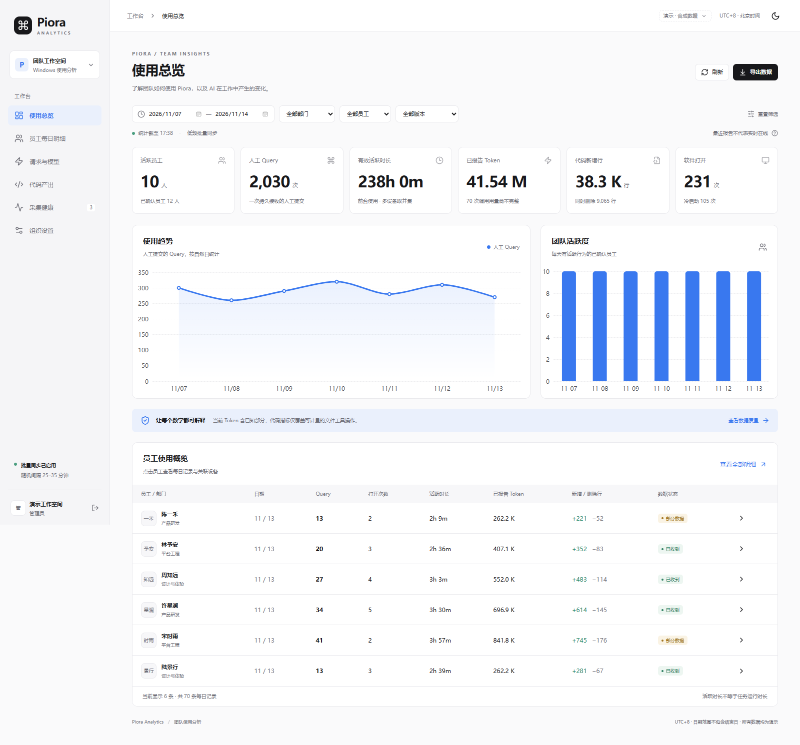

# Piora Analytics

面向 500 人以内 Windows 团队的 Piora 使用统计后端与管理看板。

**已实现 API、Worker、PostgreSQL 数据库、真实管理 UI 和配套 Piora 采集代码。已做本地数据库/API/浏览器/Windows 原生验证；尚未部署生产环境，也未给现有员工启用统计。** 演示数据仅在显式 demo 模式启用，截图使用虚构数据。详细实现范围见 [交付状态](docs/implementation-status.md)。

Piora 客户端实现与审阅入口：[PR #425](https://github.com/kexijiang/pi-desktop/pull/425)；实际接入和验证说明见 [客户端实现](docs/piora-implementation.md)。

## 本地查看

需要 Node.js 24。

~~~powershell
npm ci
npm run dev
~~~

打开 http://127.0.0.1:4318/?demo=1 查看无后端演示。侧栏切换总览、员工每日明细、请求与模型、代码产出、采集健康、设置；顶部筛选、导出、员工详情、深浅主题可交互。直接访问 / 默认连接真实 API，需要先按 [运行与部署](docs/deployment.md) 初始化数据库并启动 API/Worker。

## 开发入口

| 要解决的问题 | 文档 / 产物 |
|---|---|
| 做什么、统计口径、成熟产品比较 | [需求与选型](docs/requirements-research.md)、[指标口径](docs/metrics.md) |
| 服务边界、规模、部署 | [后端架构](docs/architecture.md) |
| 什么时候传、传什么、重试和去重 | [同步协议](docs/sync-protocol.md) |
| 全部接口与每个字段 | [OpenAPI 3.1.1](contracts/openapi.yaml)、[字段级 API 参考](docs/api-reference.md)、[业务约束](docs/api-behavior.md) |
| 表结构、索引、事务、保留 | [数据库设计](docs/database-design.md)、[字段字典](docs/database-reference.md)、[初始化 SQL](database/migrations/0001_initial.sql) |
| Piora 应改哪里、如何避免漏计/重计 | [客户端接入](docs/piora-integration.md) |
| 看板画面、交互、状态 | [UI 规范与图集](docs/ui/design.md)、[React 原型](apps/dashboard/src/App.tsx) |
| 安全、部署与运维 | [运行与部署](docs/deployment.md)、[安全与运维](docs/security-operations.md) |
| 分期开发与验收 | [开发工作项](docs/work-items.md)、[验收矩阵](docs/acceptance.md) |
| 本次实际验证范围 | [验证记录](docs/verification.md) |

## 关键决策

- 用户名来自当前 Windows 账号；安装 UUID 是设备实例标识，后台员工 ID 是人数统计标识。管理员绑定，多台设备可属于同一员工。
- 人工 Query、模型实际调用、冷启动、手动唤起、运行时长、前台活跃时长、任务耗时分别统计。
- 正常每次同步随机间隔 **25–35 分钟**；本地 SQLite 持久队列，离线补传，逐事件幂等。
- 只记录计数与分类，不上传提示词、回复、代码、diff、文件路径或模型凭证。
- PostgreSQL 18 + Node.js/Fastify API/Worker + React/TypeScript/ECharts；首期不引入 Kafka、ClickHouse、Redis。
- 原始事件和请求明细 90 天，日汇总及去重维度 24 个月。看板显示数据新鲜度和未知用量，不把缺失显示成零。

## 生成与校验

~~~powershell
npm run design:generate
npm run types:generate
npm run check
npm run typecheck
npm test
npm run test:api
npm run test:database
npm run build
npm run test:ui
~~~

PostgreSQL 集成检查只允许对名称以 _test 结尾的空数据库执行。未设置 DATABASE_URL 时，本地自动启动独立 PostgreSQL 18 测试实例；设置后要求目标为空。每个测试入口使用不同的空库。CI 使用独立 PostgreSQL 18 服务。生成器是契约及数据库字段的维护入口，CI 检查生成后是否漂移。

此仓库为私有内部服务仓库。所有示例姓名、账号、设备、Token 和截图均为合成数据。没有生产密钥或真实员工数据。
