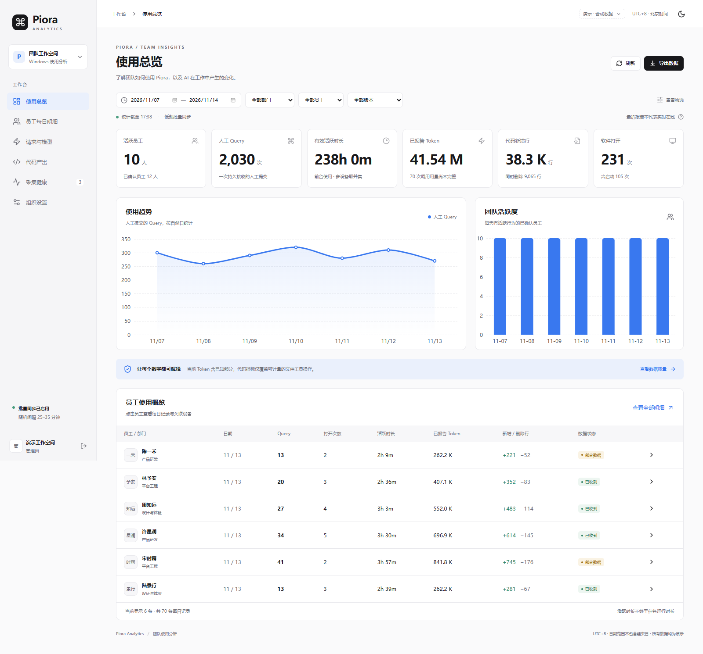
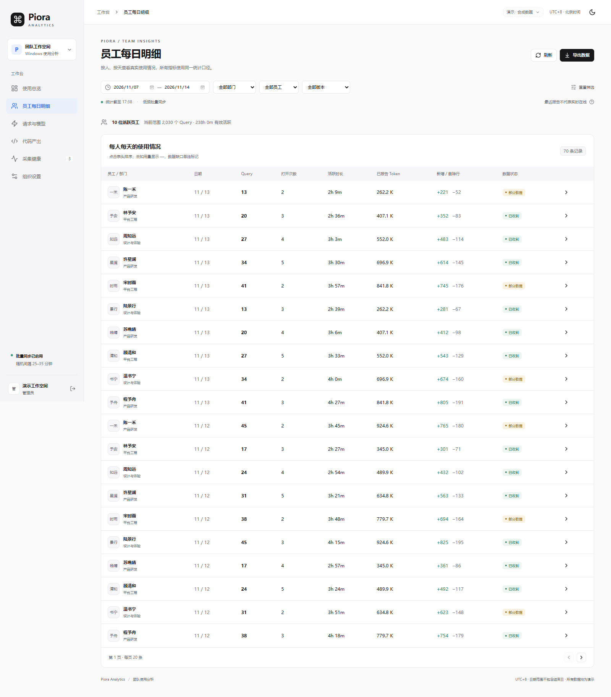
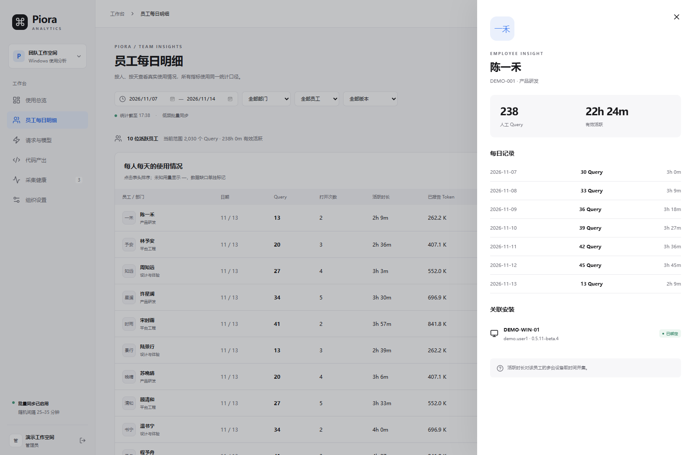
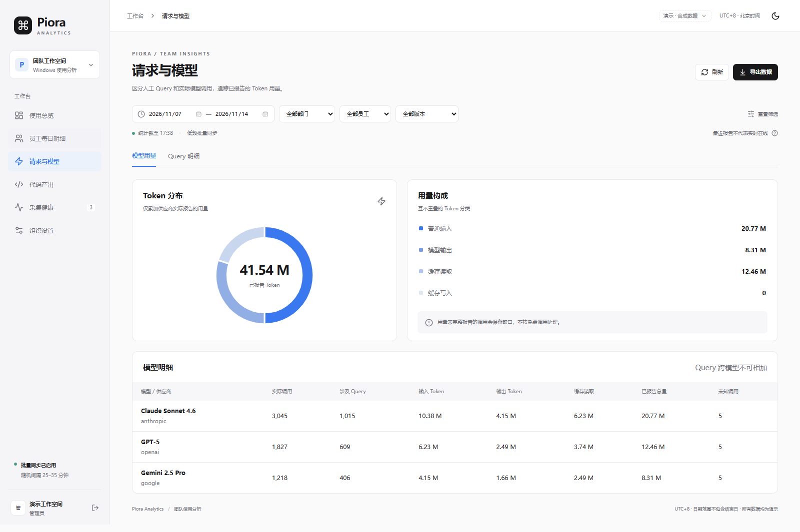
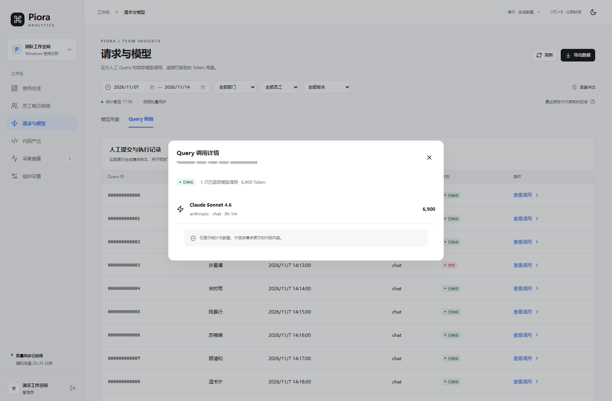
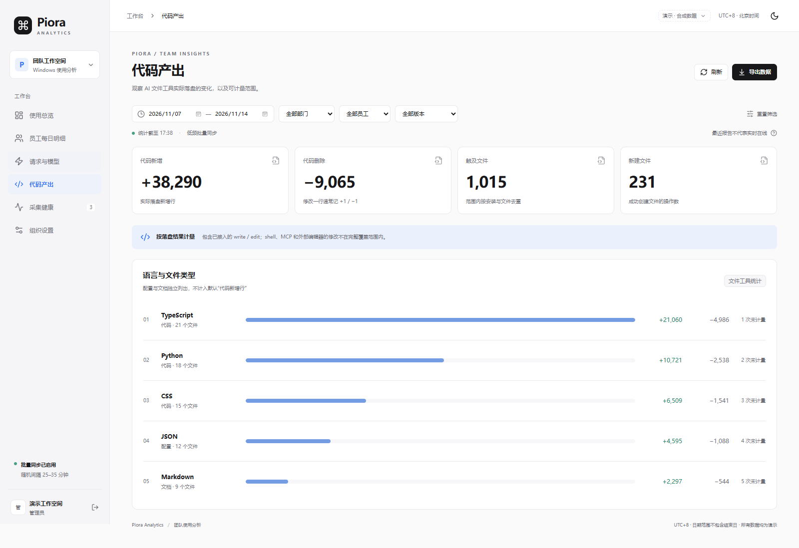
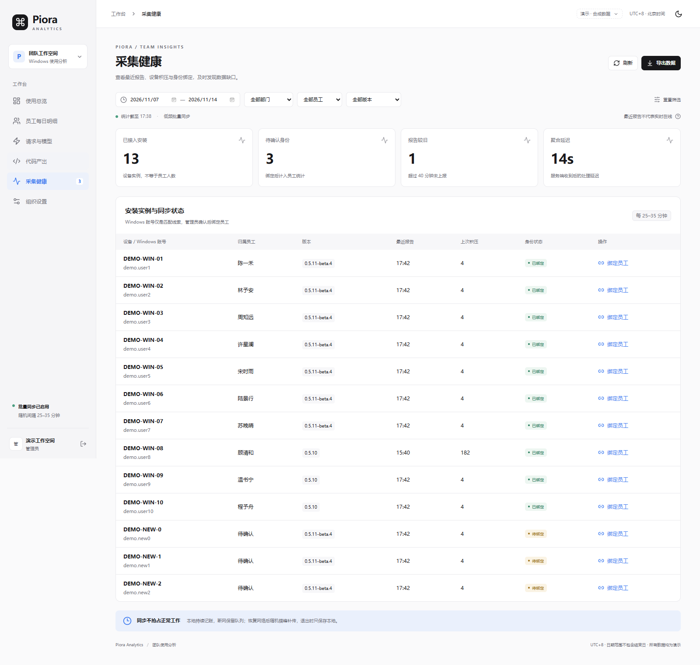
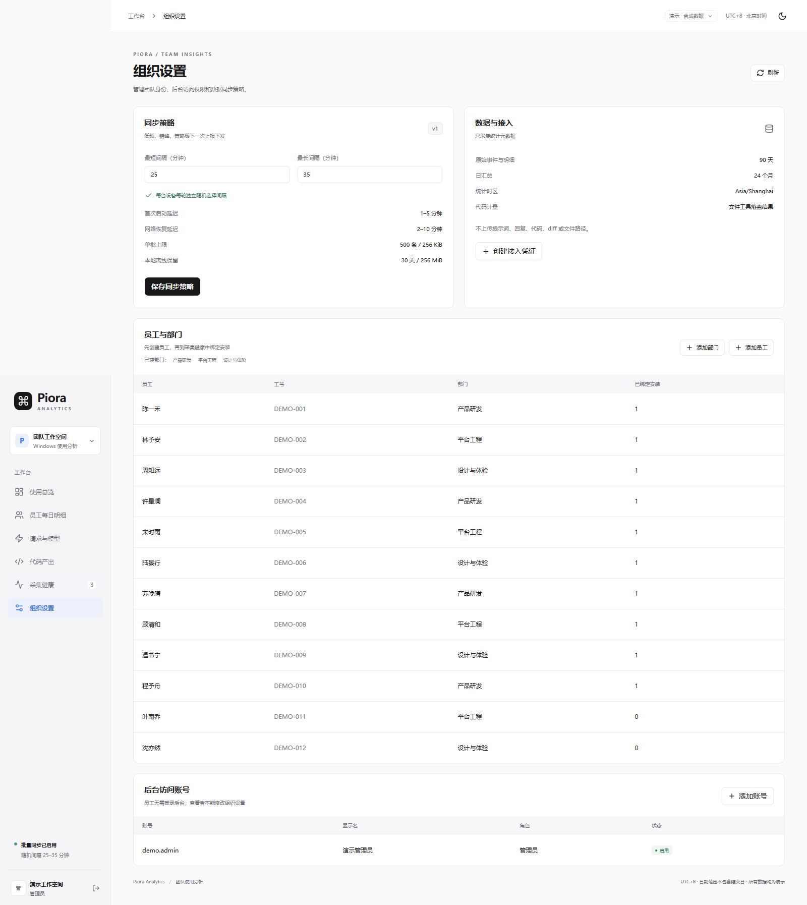
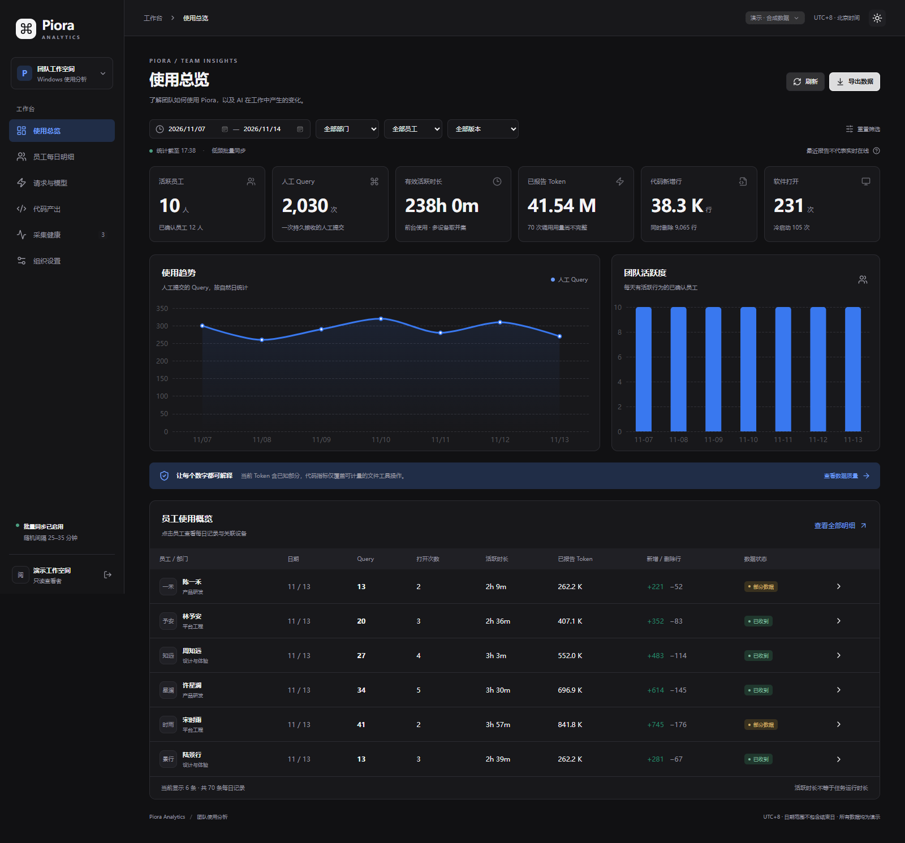
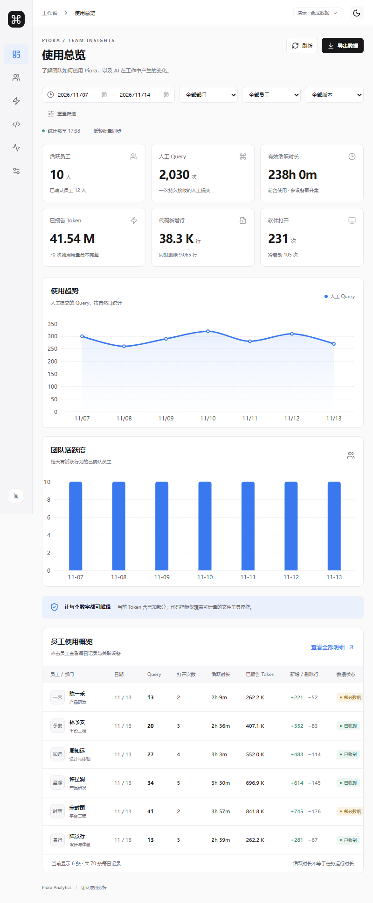

# 看板 UI 与交互规范

桌面基准 1600×1050；左侧固定导航、顶部筛选、浅灰底白卡片，Piora 蓝为唯一强调色。深色使用同一层级；800px 窄屏收紧侧栏，数据表可横向滚动。图表与业务口径共用后端契约，图像由真实 React 页面自动截图，所有数字是合成演示。

| 页面 | 回答的问题 | 主要交互 |
|---|---|---|
| 总览 | 使用人数、Query、活跃、Token、代码、打开次数 | 日期/部门/员工/版本筛选、趋势、前六条每日明细 |
| 员工每日 | 每个人每天用了多少 | 服务端分页/排序、员工详情侧栏、CSV 导出 |
| 请求与模型 | 哪些模型耗用 Token，Query 产生哪些调用 | 模型占比、缓存桶、未知用量、Query 详情 |
| 代码产出 | 文件工具实际增加/删除多少行 | 语言与类别分布、可计量覆盖提示 |
| 采集健康 | 数据新鲜度、未绑定安装、积压 | 确认安装归属、生效日期、质量提示 |
| 组织设置 | 如何接入和授权 | 员工/部门/后台账号创建、25–35 分钟策略、接入密钥 |

加载、错误/重试、空结果、只读角色均有独立状态；未知 Token 用“—”并说明覆盖，员工尚未报告不能被显示成实际使用零。最后收到时间不叫“在线”。导出只读角色可用，管理变更由服务端鉴权；前端隐藏按钮不能代替权限检查。

重新生成：npm run screenshots。脚本同时验证筛选、详情、导出、权限与状态。浏览器 fixture 不是生产员工数据；真实 API 场景另见 tests/ui/real-api.spec.ts。
